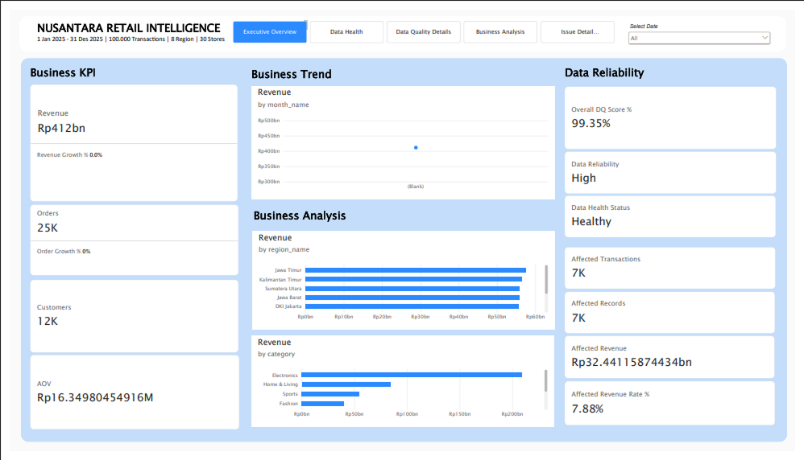
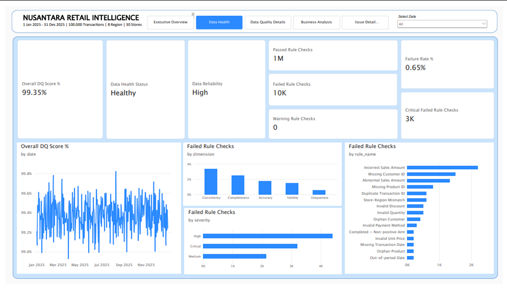
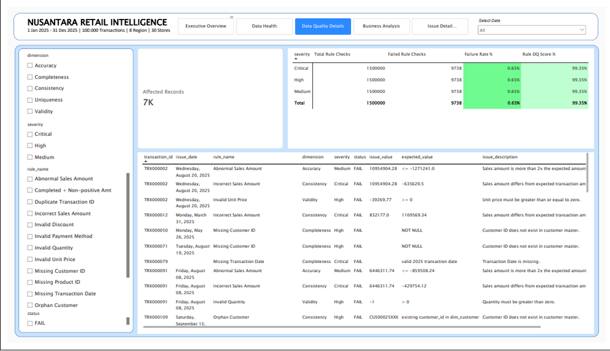
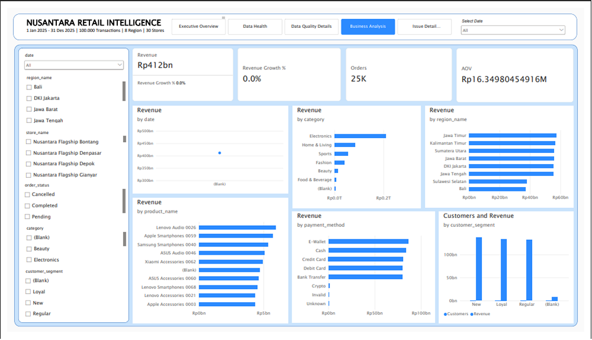
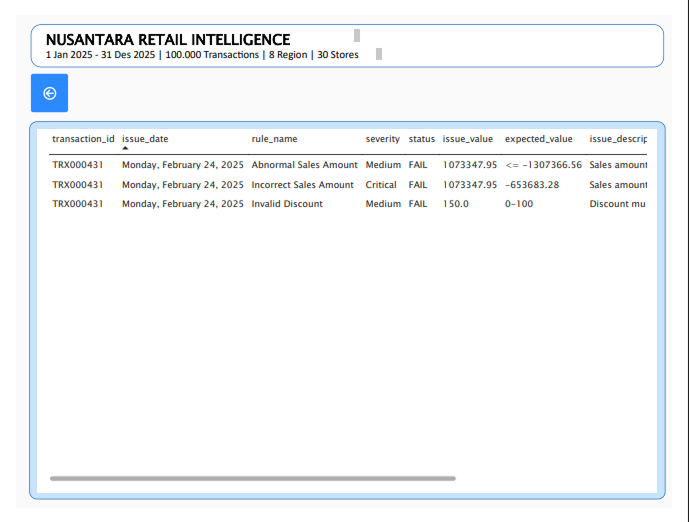

# Nusantara Retail - Data Quality & Business Monitoring Dashboard


> An end-to-end Business Intelligence solution that monitors retail business performance while measuring the reliability of the data used to report it.

**Role:** BI Developer  
**Domain:** Retail / Omnichannel Retail  
**Business Period:** January–December 2025

---

## Project Overview

Nusantara Retail is a fictional omnichannel retail company operating across multiple regions in Indonesia.

This project combines **Business Performance Monitoring** and **Data Quality Monitoring** into a single BI workflow, allowing business performance to be analyzed together with the reliability of the underlying data.

### Dashboard Preview

<table width="100%" style="table-layout: fixed;">
  <tr>
    <td width="50%" align="center">
      <strong>Dashboard Overview</strong><br>
      
    </td>
    <td width="50%" align="center">
      <strong>Data Health</strong><br>
      
    </td>
  </tr>
  <tr>
    <td width="50%" align="center">
      <strong>Data Quality Monitoring</strong><br>
      
    </td>
    <td width="50%" align="center">
      <strong>Business Analysis</strong><br>
      
    </td>
  </tr>
  <tr>
    <td width="50%" align="center">
      <strong>Issue Details</strong><br>
      
    </td>
  </tr>
</table>

---

## Key Capabilities

### Business Performance

- Revenue and revenue trend monitoring
- Order and customer analysis
- AOV analysis
- Regional, store, product, and category performance
- Customer and payment method analysis

### Data Quality

- Completeness, validity, consistency, uniqueness, and accuracy monitoring
- Duplicate and calculation validation
- Business-rule validation
- Record-level issue traceability

### Data Reliability

- Overall DQ Score
- Data Health Status
- Affected transactions and records
- Business exposure to data-quality issues

---

## Key Results

The completed implementation includes:

| Metric | Result |
|:---:|:---:|
| Sales Records | 100,000 |
| Customers | 15,000 |
| Products | 500 |
| Stores | 30 |
| Regions | 8 |
| DQ Rules | 15 |
| DQ Result Rows | 5,640 |
| DQ Issue Detail Rows | 9,738 |
| Overall DQ Score | 99.35% |

The project-defined thresholds classify the resulting data health as:

**Healthy**</br>**High Data Reliability**

> The DQ Score is a project-defined metric and is not a universal industry standard.

---

## Project Structure

```text
nusantara-retail-bi-dashboard/

├── data/
│   ├── raw/
│   └── quality/
│
├── database/
│   ├── 1_schemas.sql
│   ├── 2_raw_tables.sql
│   ├── 3_staging_tables.sql
│   ├── 4_warehouse_tables.sql
│   ├── 5_quality_tables.sql
│   └── load_postgres.py
│
├── powerbi/
│   ├── dashboard.pbix
│   └── screenshots/
│
├── docs/
│   ├── architecture.md
│   ├── business_requirements.md
│   ├── data_dictionary.md
│   └── dq_results.md
│
├── generate_dataset.py
├── dq_engine.py
├── docker-compose.yml
├── requirements.txt
├── README.md
└── .gitignore
````

---

## Documentation
<div align="center">

<table width="100%" style="table-layout: fixed;">
  <tr>
    <th width="50%">Document</th>
    <th width="50%">Purpose</th>
  </tr>
  <tr>
    <td><a href="docs/business_requirements.md"><code>business_requirements.md</code></a></td>
    <td>Business context, objectives, questions, KPIs, and dashboard requirements</td>
  </tr>
  <tr>
    <td><a href="docs/architecture.md"><code>architecture.md</code></a></td>
    <td>Technical architecture, data flow, processing layers, database, and BI model</td>
  </tr>
  <tr>
    <td><a href="docs/data_dictionary.md"><code>data_dictionary.md</code></a></td>
    <td>Dataset, table, column, key, relationship, and data-model definitions</td>
  </tr>
  <tr>
    <td><a href="docs/dq_results.md"><code>dq_results.md</code></a></td>
    <td>DQ rules, validation results, findings, scoring, and data reliability analysis</td>
  </tr>
</table>

</div>

---

## How to Run

### 1. Generate Dataset

```bash
python generate_dataset.py
```

### 2. Run Data Quality Engine

```bash
python dq_engine.py
```

Outputs:

```text
data/quality/dq_result.csv
data/quality/dq_issue_detail.csv
```

### 3. Start PostgreSQL

```bash
docker compose up -d
```

### 4. Load PostgreSQL

```bash
python database/load_postgres.py
```

### 5. Connect Power BI

Connect Power BI to the PostgreSQL database and load the analytical data from the:

```text
warehouse
quality
```

schemas.

---

## Technology Stack

**Data**

Python · Pandas · NumPy · Faker

**Database**

PostgreSQL · SQL · Docker · psycopg2

**Business Intelligence**

Power BI · Power Query · DAX

**Version Control**

Git · GitHub

---

## Limitations

* This is a synthetic portfolio project.
* Data-quality issues are intentionally injected for monitoring and validation.
* DQ thresholds and severity weights are project-defined.
* Business findings are limited to the synthetic 2025 dataset.
* The project demonstrates the BI and data-quality monitoring workflow rather than production-scale orchestration.

---
## Author

**Fardho Z.**  
Data Analyst | BI Engineer

---

<p align="center">
  © 2026 Fardho Z.
</p>

